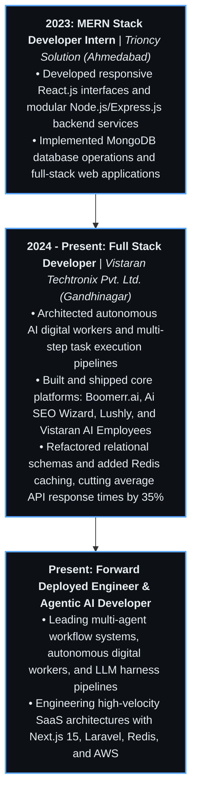

<!-- ========================================================================= -->
<!-- HEADER & HERO BANNER                                                      -->
<!-- ========================================================================= -->
<div align="center">


<br/><br/>

<a href="https://readme-typing-svg.demolab.com">
  
</a>

<p align="center">
  <b>Gandhinagar, Gujarat, India</b> &nbsp;|&nbsp;
  <b>2+ Years Building Production Systems &amp; Autonomous AI Pipelines</b>
</p>

<!-- Social & Quick Action Badges -->
<p align="center">
  <a href="https://linkedin.com/in/varunumraliya" target="_blank">
    
  </a>
  <a href="mailto:varunumraliya@gmail.com">
    
  </a>
  <a href="https://github.com/varunumraliya" target="_blank">
    
  </a>
  <a href="https://komarev.com/ghpvc/?username=varunumraliya&label=Profile%20Views&color=0e75b6&style=for-the-badge" target="_blank">
    
  </a>
</p>

</div>

---

<!-- ========================================================================= -->
<!-- ABOUT ME SECTION                                                          -->
<!-- ========================================================================= -->
## 💫 About Me

I am a **Forward Deployed Engineer & Agentic AI Developer** with over **2 years of production experience** engineering autonomous AI agents, automated task execution pipelines, and high-velocity full-stack SaaS applications.

Currently, I work at **[Vistaran Techtronix Pvt. Ltd.](https://vistaran.com)** in Gandhinagar, India, where I architect enterprise-grade AI digital workers, multi-tenant billing systems, and customer-facing web and mobile applications across multiple flagship products.

I thrive at the intersection of **cutting-edge Artificial Intelligence** and **robust software architecture**, bridging customer requirements into lightning-fast, production-ready code with **Next.js, React, TypeScript, Node.js, Laravel, Redis, and AWS**.

### ⚡ What I Do Best
- 🤖 **Autonomous AI Agents & Pipelines:** Designing multi-agent workflows, autonomous tool execution loops, and LLM harness integrations (Gemini, Claude, Codex) that automate complex business tasks.
- 🏗️ **Scalable SaaS Architecture:** Engineering full-stack platforms from ground up with clean REST/WebSocket architectures, multi-tenant workspaces, and secure subscription billing.
- 🚀 **Extreme Performance & Optimization:** Slashing database query bottlenecks in PostgreSQL/MySQL and architecting Redis caching layers (delivered **35% faster** production API response times).
- 🔌 **Mission-Critical Integrations:** Implementing third-party ecosystems including payment gateways (Stripe, Razorpay), automated communications (Twilio, WhatsApp Business API), and Shopify APIs.

---

<!-- ========================================================================= -->
<!-- SKILLS & SELF-RATING SECTION                                              -->
<!-- ========================================================================= -->
## 📊 Major Skills & Self-Rating

Here is an honest self-assessment of my core competencies, reflecting hands-on production experience, architectural depth, and real-world system delivery:

| Domain / Technology | Self-Rating | Visual Meter | Core Competencies & Capabilities |
| :--- | :---: | :---: | :--- |
| **Frontend Architecture**<br>*(React.js, Next.js, TypeScript)* | **95%** |  | Next.js 14/15 App Router, Server Actions, SSR/SSG, Tailwind CSS, performance tuning, component design systems. |
| **Backend & Real-Time APIs**<br>*(Node.js, Express, Socket.io)* | **92%** |  | High-concurrency RESTful APIs, WebSocket-driven live chats, JWT authentication, event-driven microservices. |
| **Agentic AI & LLM Systems**<br>*(Autonomous Agents, Multi-Agent Workflows)* | **90%** |  | Multi-agent orchestration, tool-calling pipelines, LLM harness frameworks, Gemini/Claude automation. |
| **SaaS & Backend Engineering**<br>*(PHP, Laravel, REST)* | **88%** |  | Multi-tenant SaaS architectures, Eloquent ORM, queue workers, payment billing, API gateway routing. |
| **Databases & Caching**<br>*(PostgreSQL, MySQL, Redis)* | **88%** |  | Query profiling, indexing strategies, Redis caching layers, connection pooling, transactional consistency. |
| **Cloud & Serverless**<br>*(AWS, Lambda, S3, Docker)* | **85%** |  | Multi-region AWS Lambda uptime monitors, S3 storage, Docker containerization, CI/CD pipelines. |
| **Third-Party & Payment Integrations**<br>*(Stripe, Razorpay, Shopify, Twilio)* | **92%** |  | Webhook lifecycle management, recurring SaaS subscriptions, WhatsApp/SMS automations, Shopify sync. |
| **Mobile App Development**<br>*(React Native, Expo, Ionic)* | **82%** |  | Cross-platform iOS/Android development, Expo Router navigation, native module bridging, push notifications. |

---

<!-- ========================================================================= -->
<!-- COMPREHENSIVE TECH STACK                                                  -->
<!-- ========================================================================= -->
## 💻 Tech Stack

### 🤖 Artificial Intelligence & Agentic Workflows


### 🎨 Frontend Engineering


### ⚙️ Backend & Architecture


### 📱 Mobile Development


### 🗄️ Databases, ORMs & Caching


### ☁️ Cloud, DevOps & Tools


### 💳 Integrations, Payments & Communications


---

<!-- ========================================================================= -->
<!-- FEATURED PRODUCTION PROJECTS                                              -->
<!-- ========================================================================= -->
## 🚀 Featured Projects & Production Systems

### 1. [Boomerr - Website Monitoring & Analytics SaaS Platform](https://boomerr.ai)
> **High-availability SaaS platform monitoring website uptime, SSL certificates, performance, and domain health in real time.**

[](https://boomerr.ai)


- 🌐 **Distributed Multi-Region Engine:** Built an automated monitoring engine utilizing **AWS Lambda and Node.js** to track site availability across global nodes, achieving **99.9% uptime tracking precision**.
- ⚡ **Sub-2-Second Webhook Alerts:** Engineered an instant notification dispatcher streaming outage and latency alerts in **< 2 seconds** directly across Slack, Discord, and WhatsApp.
- 🏢 **Multi-Tenant SaaS Infrastructure:** Built modular workspace-based access controls, interactive analytics dashboards, and end-to-end recurring subscription management via Stripe.

<details>
<summary><b>🔍 View Architecture Highlights & Technical Details</b></summary>

```
[Target Websites / APIs]
          │
  (Periodic Heartbeat)
          ▼
[AWS Lambda (Multi-Region Workers)] ──► [Redis Fast Queue]
                                                │
                                                ▼
  [Slack / Discord / WhatsApp Alerts] ◄── [Node.js Dispatcher] (<2s Latency)
                                                │
                                                ▼
                                    [MySQL / Laravel Backend]
                                                │
                                                ▼
                                   [React + TypeScript UI]
```
- **Concurrency & Reliability:** Non-blocking asynchronous checks handled via serverless worker pools.
- **Data Ingestion:** Millions of monthly latency telemetry data points efficiently aggregated and visualised.
</details>

---

### 2. [Ai SEO Wizard - AI-Powered Shopify SEO Application](https://seowizard.allgoodseo.com)
> **Enterprise Shopify application automating on-page SEO, rich snippets, and metadata generation using Gemini AI.**

[](https://seowizard.allgoodseo.com)


- 🧠 **75% Time Reduction via Gemini AI:** Integrated **Google Gemini AI** to automatically generate high-converting SEO meta tags, JSON-LD structured data, and keyword optimizations for unlimited Shopify catalog items.
- 🖼️ **Automated Asset Optimization:** Implemented automated WebP image transcoding, dynamic alt-tag injection, and broken-link discovery sweeps.
- 🔄 **Seamless Shopify Sync:** Integrated with Shopify Admin GraphQL/REST APIs to synchronize catalog updates bidirectionally without performance overhead.

<details>
<summary><b>🔍 View AI Workflow & Optimization Pipeline</b></summary>

- **LLM Pipeline:** Ingests product title, description, and target demographics → passes structured schema prompts to Gemini AI → validates JSON-LD compliance → commits directly to Shopify store headers via Shopify API.
- **Batch Processing:** Background queue workers parse tens of thousands of SKUs asynchronously without hitting rate limits.
</details>

---

### 3. [Lushly - Urban Gardening & Plant Care Mobile Platform](https://lushlyapp.com)
> **Cross-platform mobile application facilitating plant care subscriptions, real-time gardener dispatching, and in-app consultations.**

[](https://lushlyapp.com)


- 📱 **Cross-Platform Excellence:** Crafted smooth native experiences for iOS & Android using **React Native and Expo Router**, with offline-first state caching and reactive UI layouts.
- 💬 **Real-Time Communication & Booking:** Engineered a smart gardener slot reservation scheduler and dynamic in-app live chat via **WebSockets and Laravel**.
- 🔒 **End-to-End Security & Payments:** Implemented phone OTP verification, visit completion authentication tokens, and **Razorpay recurring subscription** billing.

---

### 4. 🏢 Vistaran AI Employees & Core Enterprise Platforms
> **Production AI workers and multi-tenant platforms powering digital operations at [Vistaran Techtronix](https://vistaran.com).**


- 🤖 **Autonomous AI Task Execution:** Architected task execution pipelines for **Vistaran AI Employees**, empowering digital workers to trigger external APIs, parse documents, and execute multi-step workflows.
- 🚀 **35% Latency Reduction:** Refactored relational queries and designed an intelligent **Redis caching layer**, eliminating production database bottlenecks and cutting average API response times by **35%**.
- 🛠️ **Multi-Product Deployment:** Built and scaled features across 4 core products: *Vistaran AI Employees*, *Laabh POS*, *The Accessbox*, and *Help Me Buddy*.

---

<!-- ========================================================================= -->
<!-- PROFESSIONAL EXPERIENCE & TIMELINE                                        -->
<!-- ========================================================================= -->
## 💼 Professional Experience



### 🔹 Full Stack Developer | [Vistaran Techtronix Pvt. Ltd.](https://vistaran.com)
**Gandhinagar, India** | *Sep 2024 - Present*
- Architect and maintain enterprise SaaS web and mobile platforms using **React, Next.js, TypeScript, Node.js, Angular, and Laravel**.
- Developed autonomous AI agent pipelines enabling automated multi-step task execution via external APIs.
- Integrated **Stripe, Razorpay, WebSockets, Twilio, WhatsApp Business API, and AWS** services across multi-tenant applications.
- Optimized query structures and implemented Redis caching, achieving a **35% reduction in API response times**.

### 🔹 MERN Stack Developer Intern | Trioncy Solution
**Ahmedabad, India** | *Oct 2023 - Dec 2023*
- Developed responsive, component-driven user interfaces in **React.js**.
- Built modular backend services and REST APIs with **Node.js, Express.js, and MongoDB**.

---

<!-- ========================================================================= -->
<!-- EDUCATION & CERTIFICATIONS                                                -->
<!-- ========================================================================= -->
## 🎓 Education & Certifications

- 🎓 **Bachelor of Technology (B.Tech)** in Information and Communication Technology  
  *Marwadi University (2021 - 2025)*
- ☁️ **AWS Academy Cloud Foundations** *(2024)*
- 🗄️ **Oracle Academy Database Foundations** *(2023)*

---

<!-- ========================================================================= -->
<!-- GITHUB STATS & ANALYTICS                                                  -->
<!-- ========================================================================= -->
## 📈 GitHub Analytics & Activity

<div align="center">

<!-- GitHub Stats & Streak Cards -->
<p align="center">
  
  
</p>

<!-- Top Languages Card & Quote -->
<p align="center">
  
  
</p>

<!-- Activity Graph -->
<p align="center">
  
</p>

</div>

---

<!-- ========================================================================= -->
<!-- CONNECT & FOOTER                                                          -->
<!-- ========================================================================= -->
<div align="center">

### 🤝 Let's Collaborate & Build Something Exceptional

Whether you're looking to build an **autonomous AI worker**, architect a **high-throughput SaaS application**, or optimize existing full-stack infrastructure, I'd love to connect!

[](https://linkedin.com/in/varunumraliya)
[](mailto:varunumraliya@gmail.com)
[](https://github.com/varunumraliya)

<br/>

```
"Code is like humor. When you have to explain it, it's bad." - Cory House
```

<p align="center">
  <sub>Crafted with passion, precision, and modern web engineering by <b>Varun Umraliya</b>.</sub>
</p>

</div>
