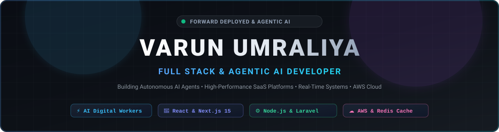

<!-- ========================================================================= -->
<!-- HEADER & HERO BANNER                                                      -->
<!-- ========================================================================= -->
<div align="center">



<br/><br/>

<a href="https://readme-typing-svg.demolab.com">
  
</a>

<p align="center">
  <b>Gandhinagar, Gujarat, India</b> &nbsp;|&nbsp;
  <b>2+ Years Building Production Apps &amp; AI Systems</b>
</p>

<!-- Social & Quick Action Badges -->
<p align="center">
  <a href="https://linkedin.com/in/varunumraliya" target="_blank">
    
  </a>
  <a href="mailto:varunumraliya@gmail.com">
    
  </a>
  <a href="https://github.com/varunumraliya" target="_blank">
    
  </a>
  <a href="https://komarev.com/ghpvc/?username=varunumraliya&label=Profile%20Views&color=0e75b6&style=for-the-badge" target="_blank">
    
  </a>
</p>

</div>

---

<!-- ========================================================================= -->
<!-- ABOUT ME SECTION                                                          -->
<!-- ========================================================================= -->
## 💫 About Me

I am a **Forward Deployed Engineer & Agentic AI Developer** with over **2 years of experience** building AI workers, automated task pipelines, and full-stack web and mobile apps.

Currently, I work at **[Vistaran Techtronix Pvt. Ltd.](https://vistaran.com)** in Gandhinagar, India. I build AI workers that automate daily business tasks, connect payment systems, and scale apps like *Vistaran AI Employees, Laabh POS, The Accessbox,* and *Help Me Buddy*.

I enjoy solving real-world problems and turning ideas into clean, fast, and easy-to-use software using **React, Next.js, TypeScript, Node.js, Laravel, Redis, and AWS**.

### ⚡ What I Do Best
- 🤖 **AI Workers & Automation:** Building smart AI agents and multi-step workflows (using Gemini and Claude) that connect with APIs to automate daily tasks.
- 🌐 **Full-Stack Web & Mobile Apps:** Developing responsive websites and cross-platform mobile apps with Next.js, React, React Native, and Laravel.
- 🚀 **Speed & Optimization:** Improving database queries in PostgreSQL/MySQL and adding Redis caching (made API response times **35% faster**).
- 💳 **Payments & Integrations:** Connecting third-party services like Stripe, Razorpay, Twilio, WhatsApp API, and Shopify.

---

<!-- ========================================================================= -->
<!-- SKILLS & SELF-RATING SECTION                                              -->
<!-- ========================================================================= -->
## 📊 Major Skills & Self-Rating

Here is a quick overview of my key skills and self-rating based on my day-to-day work:

| Skill / Domain | Self-Rating | Progress Meter | What I Work With |
| :--- | :---: | :---: | :--- |
| **Frontend Development**<br>*(React.js, Next.js, TypeScript)* | **95%** |  | Next.js 14/15, React, TypeScript, Tailwind CSS, clean UI components, and fast page loads. |
| **Backend & Real-Time APIs**<br>*(Node.js, Express, Socket.io)* | **92%** |  | Fast REST APIs, live chat with WebSockets, and secure login with JWT. |
| **AI Workers & Automation**<br>*(AI Agents, Multi-Step Workflows)* | **90%** |  | AI agents, tool-calling pipelines, Gemini and Claude models, and automated workflows. |
| **SaaS & Web Development**<br>*(PHP, Laravel, REST)* | **88%** |  | Laravel apps, database structure, background queues, and user subscription billing. |
| **Databases & Caching**<br>*(PostgreSQL, MySQL, Redis)* | **88%** |  | Writing clean queries, adding database indexes, and using Redis to speed up data access. |
| **Cloud & Deployment**<br>*(AWS, Lambda, S3, Docker)* | **85%** |  | AWS Lambda for serverless jobs, S3 for file storage, and Docker containers. |
| **Payments & Integrations**<br>*(Stripe, Razorpay, Shopify, Twilio)* | **92%** |  | Recurring subscriptions, WhatsApp and SMS alerts with Twilio, and Shopify store sync. |
| **Mobile App Development**<br>*(React Native, Expo, Ionic)* | **82%** |  | Cross-platform apps for Android and iOS using React Native and Expo Router. |

---

<!-- ========================================================================= -->
<!-- COMPREHENSIVE TECH STACK                                                  -->
<!-- ========================================================================= -->
## 💻 Tech Stack

### 🤖 Artificial Intelligence & Agentic Workflows


### 🎨 Frontend Engineering


### ⚙️ Backend & Architecture


### 📱 Mobile Development


### 🗄️ Databases, ORMs & Caching


### ☁️ Cloud, DevOps & Tools


### 💳 Integrations, Payments & Communications


---

<!-- ========================================================================= -->
<!-- FEATURED PRODUCTION PROJECTS                                              -->
<!-- ========================================================================= -->
## 🚀 Featured Projects

### 1. [Boomerr - Website Monitoring & Analytics Platform](https://boomerr.ai)
> **A web platform that monitors website uptime, SSL certificates, speed, and domain health 24/7.**

[](https://boomerr.ai)


- 🌐 **Global Monitoring Engine:** Built an automated monitoring system using **AWS Lambda and Node.js** to track site status across global regions with 99.9% uptime accuracy.
- ⚡ **Fast Alerts in Under 2 Seconds:** Created an instant alert system that notifies users through Slack, Discord, and WhatsApp as soon as an issue occurs.
- 🏢 **User Workspaces & Billing:** Added workspace-based access control, analytics dashboards, and recurring monthly payments using Stripe.

<details>
<summary><b>🔍 View How It Works</b></summary>

```
[Websites / APIs Being Checked]
               │
      (Periodic Ping Checks)
               ▼
[AWS Lambda (Multi-Region Workers)] ──► [Redis Fast Queue]
                                                │
                                                ▼
  [Slack / Discord / WhatsApp Alerts] ◄── [Node.js Dispatcher] (<2s Delivery)
                                                │
                                                ▼
                                    [MySQL / Laravel Backend]
                                                │
                                                ▼
                                   [React + TypeScript UI]
```
- **Fast and Reliable:** Runs automatic checks in the background using serverless functions.
- **Easy Dashboards:** Displays site latency and uptime history in clear charts.
</details>

---

### 2. [Ai SEO Wizard - Shopify SEO Tool](https://seowizard.allgoodseo.com)
> **A Shopify app that automatically improves SEO for products, collections, pages, and blog posts using Gemini AI.**

[](https://seowizard.allgoodseo.com)


- 🧠 **Saved 75% Manual Work with Gemini AI:** Integrated **Google Gemini AI** to automatically write SEO titles, descriptions, and keyword tags for unlimited Shopify products.
- 🖼️ **Image Optimization:** Added automatic conversion of images to WebP format, image alt-tag generators, and broken-link checks.
- 🔄 **Direct Shopify Sync:** Connected to Shopify APIs to update product SEO details directly without slowing down store performance.

<details>
<summary><b>🔍 View AI Workflow Details</b></summary>

- **How it Works:** Reads product title and details → sends structured prompts to Gemini AI → validates the SEO format → updates the Shopify store directly using the Shopify API.
- **Batch Updates:** Automatically processes thousands of items in the background without hitting API limits.
</details>

---

### 3. [Lushly - Plant Care & Gardening Mobile App](https://lushlyapp.com)
> **A mobile app for booking plant care services, reserving time slots, and scheduling visits from local gardeners.**

[](https://lushlyapp.com)


- 📱 **Smooth Mobile Experience:** Built an easy-to-use mobile app for iOS and Android using **React Native and Expo**, with fast navigation and offline support.
- 💬 **Live Chat & Slot Booking:** Created a slot reservation calendar and real-time chat between customers and gardeners using **WebSockets and Laravel**.
- 🔒 **Safe Payments & OTP Verification:** Added phone OTP login, visit completion codes, and recurring monthly service payments with **Razorpay**.

---

### 4. 🏢 Vistaran AI Employees & Core Products
> **AI digital workers and software tools built for daily business workflows at [Vistaran Techtronix](https://vistaran.com).**


- 🤖 **AI Task Automation:** Built AI workers for **Vistaran AI Employees** that can read data, trigger external APIs, and complete multi-step tasks on their own.
- 🚀 **35% Faster Response Times:** Cleaned up database queries and added a **Redis cache**, cutting average API response times by **35%**.
- 🛠️ **Multi-App Development:** Built and scaled features across 4 core apps: *Vistaran AI Employees, Laabh POS, The Accessbox,* and *Help Me Buddy*.

---

<!-- ========================================================================= -->
<!-- PROFESSIONAL EXPERIENCE & TIMELINE                                        -->
<!-- ========================================================================= -->
## 💼 Professional Experience

| Timeline | Role | Organization | What I Did & Built |
| :---: | :--- | :--- | :--- |
| **Sep 2024 - Present** | **Full Stack Developer** | **[Vistaran Techtronix Pvt. Ltd.](https://vistaran.com)**<br>📍 *Gandhinagar, Gujarat, India* | • Built AI digital workers and automated task pipelines<br>• Developed core products: *Vistaran AI Employees, Laabh POS, The Accessbox, Help Me Buddy*<br>• Integrated Stripe, Razorpay, WebSockets, Twilio, WhatsApp API, and AWS<br>• Added Redis caching and tuned queries, making APIs **35% faster** |
| **Oct 2023 - Dec 2023** | **MERN Stack Developer Intern** | **Trioncy Solution**<br>📍 *Ahmedabad, Gujarat, India* | • Built responsive React.js UI components and web pages<br>• Developed backend REST APIs and database features using Node.js, Express, and MongoDB |

<br/>

<details open>
<summary><b>📋 Detailed Responsibilities & Work Summary</b></summary>
<br/>

#### 🔹 Full Stack Developer | [Vistaran Techtronix Pvt. Ltd.](https://vistaran.com)
*Sep 2024 - Present • Gandhinagar, India*
- **AI Digital Workers:** Designed and built automated AI agents for *Vistaran AI Employees* that can call external APIs and complete multi-step tasks automatically.
- **Production Web & Mobile Apps:** Built and maintained applications using **React, Next.js, TypeScript, Node.js, Angular, and Laravel** across 4 main products (*Vistaran AI Employees, Laabh POS, The Accessbox, Help Me Buddy*).
- **Payment & Messaging Systems:** Integrated Stripe and Razorpay payment gateways, WebSockets, Twilio SMS, WhatsApp messaging, and AWS services.
- **Performance Improvements:** Improved PostgreSQL and MySQL database queries and set up a Redis caching layer, making APIs **35% faster** under heavy use.

#### 🔹 MERN Stack Developer Intern | Trioncy Solution
*Oct 2023 - Dec 2023 • Ahmedabad, India*
- Built responsive user interfaces and components in React.js.
- Developed backend REST APIs with Node.js and Express.js, and handled MongoDB database operations.

</details>

---

<!-- ========================================================================= -->
<!-- EDUCATION & CERTIFICATIONS                                                -->
<!-- ========================================================================= -->
## 🎓 Education & Certifications

- 🎓 **Bachelor of Technology (B.Tech)** in Information and Communication Technology  
  *Marwadi University (2021 - 2025)*
- ☁️ **AWS Academy Cloud Foundations** *(2024)*
- 🗄️ **Oracle Academy Database Foundations** *(2023)*

---

<!-- ========================================================================= -->
<!-- GITHUB STATS & ANALYTICS                                                  -->
<!-- ========================================================================= -->
## 📈 GitHub Analytics & Activity

<div align="center">

<!-- GitHub Stats & Streak Cards -->
<p align="center">
  
  
</p>

<!-- Top Languages Card & Quote -->
<p align="center">
  
  
</p>

<!-- Activity Graph -->
<p align="center">
  
</p>

</div>

---

<!-- ========================================================================= -->
<!-- CONNECT & FOOTER                                                          -->
<!-- ========================================================================= -->
<div align="center">

### 🤝 Let's Connect & Work Together

Whether you want to build an **AI worker**, develop a **fast web or mobile app**, or improve your existing software, feel free to reach out!

[](https://linkedin.com/in/varunumraliya)
[](mailto:varunumraliya@gmail.com)
[](https://github.com/varunumraliya)

<br/>

```
"Code is like humor. When you have to explain it, it's bad." - Cory House
```

<p align="center">
  <sub>Built by <b>Varun Umraliya</b>.</sub>
</p>

</div>
